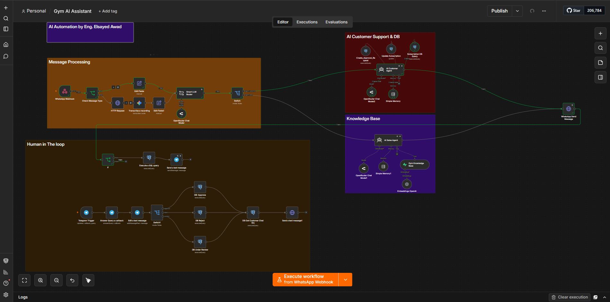
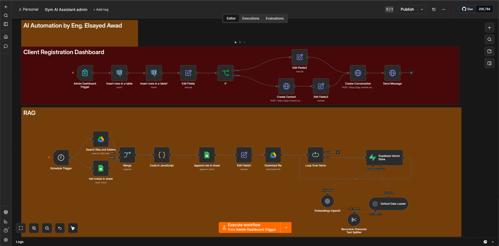
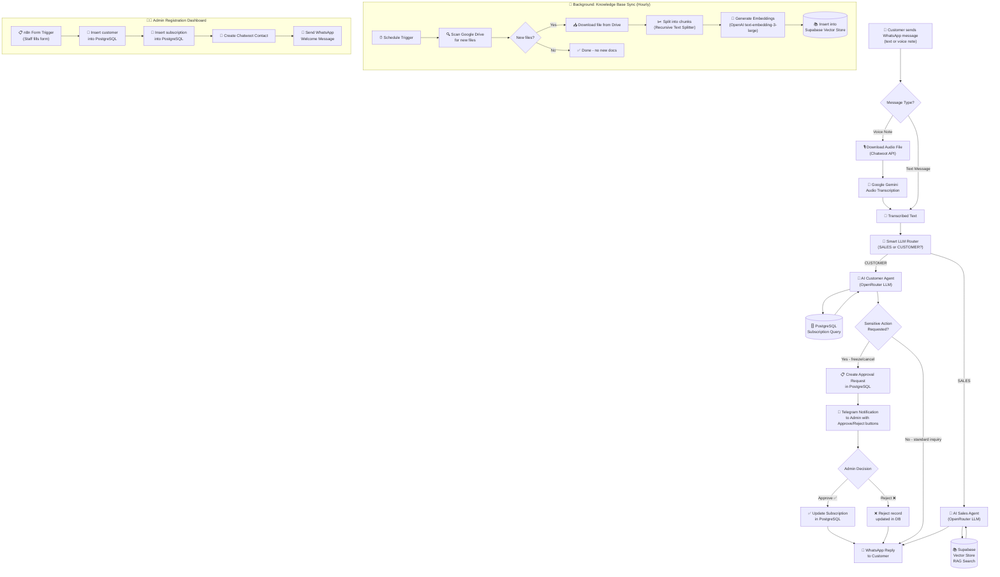

# 🏋️ GymFlow AI — Intelligent Gym Automation System

<div align="center">


**An AI-powered automation system for gym management — handling customer service, subscriptions, sales inquiries, and admin approvals through WhatsApp and Telegram.**

[Workflows](#-workflows) · [Architecture](#-system-architecture) · [Setup](#-getting-started) · [Import Guide](#-importing-workflows-into-n8n) · [Security](#-security)

</div>

---

## 📋 Table of Contents

- [Overview](#-overview)
- [The Problem & Solution](#-the-problem--solution)
- [Key Features](#-key-features)
- [System Screenshots](#-system-screenshots)
- [Technology Stack](#-technology-stack)
- [Project Structure](#-project-structure)
- [System Architecture](#-system-architecture)
- [Workflows](#-workflows)
- [Getting Started](#-getting-started)
- [Importing Workflows into n8n](#-importing-workflows-into-n8n)
- [Environment Variables](#-environment-variables)
- [Usage Scenarios](#-usage-scenarios)
- [Future Development](#-future-development)
- [Security](#-security)
- [License](#-license)

---

## 🔍 Overview

**GymFlow AI** is a fully automated gym management system built on **n8n** (a workflow automation platform). It acts as an intelligent AI layer between your gym's customers and your operations team — handling real-time WhatsApp conversations, managing subscriptions in a PostgreSQL database, populating a Supabase vector knowledge base, and routing sensitive decisions to gym management via a Telegram admin panel.

> Built by **Eng. Elsayed Awad** as a production-ready AI automation solution for gyms.

---

## 🎯 The Problem & Solution

### The Problem

Modern gyms face a constant flood of repetitive customer inquiries:
- "What are your membership prices?"
- "When does my subscription expire?"
- "I want to freeze my membership for two weeks."
- "What are the gym hours for women?"

Handling these manually consumes staff time, leads to slow responses, and creates inconsistent customer experiences — especially outside business hours.

### The Solution

GymFlow AI automates the entire customer journey:

| Customer Action | GymFlow AI Response |
|---|---|
| Sends a WhatsApp text message | AI routes to appropriate agent |
| Sends a voice note | Transcribes audio, then processes as text |
| Asks about prices/hours | AI Sales Agent queries knowledge base and responds in Arabic |
| Asks about their subscription | AI Customer Agent queries the database using their phone number |
| Requests a freeze/cancellation | System creates an approval request and notifies management on Telegram |
| Management approves/rejects | Customer receives instant WhatsApp notification |

---

## ✨ Key Features

The following features are confirmed by the workflow files in this repository:

- **🤖 Dual AI Agent Architecture** — A dedicated **Sales Agent** for gym information and a **Customer Service Agent** for account management, each with specialized system prompts and tool access.
- **🧠 Smart LLM Router** — Automatically classifies incoming messages as `CUSTOMER` or `SALES` intent using an LLM, then routes to the correct agent.
- **🎙️ Voice Message Transcription** — Supports WhatsApp voice notes via Google Gemini audio transcription, converting speech to text before processing.
- **📚 RAG Knowledge Base** — A Retrieval-Augmented Generation (RAG) pipeline stores gym documents (prices, schedules, policies) in a Supabase vector store, enabling accurate, grounded AI responses.
- **🗄️ Automatic Knowledge Base Sync** — A scheduled trigger (hourly) automatically scans a Google Drive folder, identifies new documents, and ingests them into the Supabase vector store.
- **👤 Customer Account Management** — The Customer Agent can query PostgreSQL for subscription status (start date, end date, duration, status) using the customer's phone number.
- **🔐 Human-in-the-Loop (HITL) Approvals** — Sensitive actions (freeze, cancel, modify subscription) are never executed automatically. The system creates a database record and sends a Telegram message with Approve / Reject / Contact buttons.
- **📊 Admin Registration Dashboard** — An n8n Form-based dashboard allows gym staff to register new customers, with automatic PostgreSQL insertion and WhatsApp welcome message dispatch.
- **📱 Chatwoot Integration** — Outgoing WhatsApp messages are sent via the Chatwoot API, maintaining a unified inbox.

---

## 🖼️ System Screenshots

### Workflow Overview — Main Automation Pipeline



*The main n8n workflow showing the WhatsApp webhook, AI routing, dual agent architecture, voice transcription, Telegram HITL approval system, and database integration.*

---

### Admin Registration Dashboard & Knowledge Base Pipeline



*The registration dashboard (n8n Form trigger) for adding new gym members, alongside the automated Google Drive → Supabase RAG ingestion pipeline.*

---

## 🛠️ Technology Stack

| Category | Technology |
|---|---|
| **Workflow Automation** | [n8n](https://n8n.io) (self-hosted or cloud) |
| **AI Chat Models** | OpenRouter API (nvidia/nemotron models) |
| **AI Embeddings** | OpenAI API (`text-embedding-3-large`) |
| **Audio Transcription** | Google Gemini (gemini-flash-lite) |
| **Vector Store / Knowledge Base** | [Supabase](https://supabase.com) (pgvector) |
| **Relational Database** | PostgreSQL (via Supabase or standalone) |
| **Messaging (WhatsApp)** | [Chatwoot](https://www.chatwoot.com) + WhatsApp Business |
| **Admin Notifications** | Telegram Bot API |
| **Document Storage** | Google Drive |
| **Processed File Tracking** | Google Sheets |

---

## 📁 Project Structure

```
GymFlow-AI/
│
├── workflows/                          # n8n workflow JSON files
│   ├── gym-ai-assistant-main.json      # Main workflow: WhatsApp AI, HITL, agents
│   └── gym-ai-assistant-registration.json  # Registration & knowledge base pipeline
│
├── assets/
│   └── images/
│       ├── workflow-overview.png       # Screenshot of the main workflow
│       └── admin-dashboard.png        # Screenshot of admin & RAG pipeline
│
├── docs/                               # Additional documentation (future)
│
├── .env.example                        # Template for environment variables
├── .gitignore                          # Git ignore rules
├── LICENSE                             # MIT License
├── SECURITY.md                         # Security policy & vulnerability reporting
└── README.md                           # This file
```

---

## 🏗️ System Architecture

### End-to-End Flow Diagram



---

## 📦 Workflows

### 1. `gym-ai-assistant-main.json` — Main Automation Pipeline

This is the core AI workflow. It handles:

- **WhatsApp Webhook** — receives incoming messages from Chatwoot
- **Message Type Detection** — routes text messages vs. voice notes
- **Voice Transcription** — transcribes audio using Google Gemini
- **Smart LLM Router** — classifies intent as `SALES` or `CUSTOMER`
- **AI Sales Agent** — answers gym-related inquiries from vector knowledge base
- **AI Customer Agent** — manages subscriptions, handles HITL approval requests
- **Telegram Admin Panel** — sends approval requests with interactive buttons
- **Decision Processing** — handles approve/reject callbacks from Telegram
- **WhatsApp Reply** — sends final response back to customer via Chatwoot

### 2. `gym-ai-assistant-registration.json` — Registration & Knowledge Base Pipeline

This workflow handles two separate sub-flows:

**Sub-flow A: Customer Registration Dashboard**
- n8n Form Trigger (admin-facing)
- Inserts new customer into `customers` table
- Inserts subscription record into `subscriptions` table
- Creates a Chatwoot contact
- Sends a WhatsApp welcome message

**Sub-flow B: Automated Knowledge Base Ingestion**
- Hourly schedule trigger
- Scans a designated Google Drive folder for new PDF/document files
- Compares against a tracking Google Sheet to identify unprocessed files
- Downloads, chunks, and embeds new documents into Supabase vector store

---

## 🚀 Getting Started

### Prerequisites

Before importing the workflows, ensure you have the following services configured:

| Service | Purpose | Notes |
|---|---|---|
| n8n instance | Workflow runner | v1.0+ recommended, self-hosted or cloud |
| Supabase project | Vector store + PostgreSQL | Enable pgvector extension |
| Chatwoot instance | WhatsApp inbox management | With a connected WhatsApp Business number |
| Telegram Bot | Admin approval panel | Create via @BotFather |
| OpenRouter account | AI chat models | Free tier available |
| OpenAI account | Text embeddings | Requires paid API access |
| Google Cloud account | Gemini transcription + Drive/Sheets | Enable required APIs |

### Database Schema

Before activating the workflows, create the following tables in your PostgreSQL/Supabase database:

```sql
-- Customers table
CREATE TABLE customers (
    id SERIAL PRIMARY KEY,
    name VARCHAR(255) NOT NULL,
    phone VARCHAR(20) NOT NULL UNIQUE,
    age INTEGER,
    created_at TIMESTAMP DEFAULT NOW()
);

-- Subscriptions table
CREATE TABLE subscriptions (
    id SERIAL PRIMARY KEY,
    customer_id INTEGER REFERENCES customers(id),
    start_date DATE NOT NULL,
    end_date DATE,
    duration_months INTEGER NOT NULL,
    status VARCHAR(50) DEFAULT 'active',
    created_at TIMESTAMP DEFAULT NOW()
);

-- Approval requests table (for HITL freeze/cancel requests)
CREATE TABLE approval_requests (
    id SERIAL PRIMARY KEY,
    customer_id INTEGER REFERENCES customers(id),
    action_type VARCHAR(100) NOT NULL,
    requested_parameters JSONB,
    status VARCHAR(50) DEFAULT 'pending',
    conversation_id VARCHAR(100),
    account_id VARCHAR(100),
    created_at TIMESTAMP DEFAULT NOW()
);

-- Enable pgvector for knowledge base (Supabase)
CREATE EXTENSION IF NOT EXISTS vector;

-- Documents table for RAG knowledge base
CREATE TABLE documents (
    id BIGSERIAL PRIMARY KEY,
    content TEXT,
    metadata JSONB,
    embedding VECTOR(3072)  -- matches text-embedding-3-large dimensions
);
```

### Setting Up Supabase Vector Store

In your Supabase project, run the following to enable vector similarity search:

```sql
-- Create the match_documents function required by n8n Supabase Vector Store node
CREATE OR REPLACE FUNCTION match_documents (
  query_embedding VECTOR(3072),
  match_count INT DEFAULT 5,
  filter JSONB DEFAULT '{}'
) RETURNS TABLE (
  id BIGINT,
  content TEXT,
  metadata JSONB,
  similarity FLOAT
)
LANGUAGE PLPGSQL AS $$
BEGIN
  RETURN QUERY
  SELECT
    d.id,
    d.content,
    d.metadata,
    1 - (d.embedding <=> query_embedding) AS similarity
  FROM documents d
  WHERE d.metadata @> filter
  ORDER BY d.embedding <=> query_embedding
  LIMIT match_count;
END;
$$;
```

---

## 📥 Importing Workflows into n8n

> ⚠️ **Important**: After importing, you MUST manually configure all credentials inside n8n. The JSON files contain placeholder values — no credentials are stored in the files.

### Step-by-Step Import

1. **Open your n8n instance** in a browser.

2. **Navigate to Workflows** → Click **"+ New Workflow"** or go to the Workflows list.

3. **Import the first workflow**:
   - Click the **three-dot menu (⋮)** in the top-right corner of the workflow editor.
   - Select **"Import from File"**.
   - Choose `workflows/gym-ai-assistant-main.json`.
   - Click **"Import"**.

4. **Import the second workflow**:
   - Repeat the same process with `workflows/gym-ai-assistant-registration.json`.

5. **Configure Credentials** (see section below).

6. **Activate the workflows** by toggling the **Active** switch on each workflow.

### Configuring Credentials After Import

After import, go to each node that shows a credential error and configure:

| Credential Type | n8n Credential Name | Used In |
|---|---|---|
| OpenRouter API | `openRouterApi` | LLM chat nodes (Sales & Customer agents) |
| OpenAI API | `openAiApi` | Embeddings nodes |
| Google Gemini (PaLM) API | `googlePalmApi` | Audio transcription node |
| Supabase API | `supabaseApi` | Vector store nodes |
| PostgreSQL | `postgres` | All database query nodes |
| Telegram API | `telegramApi` | Telegram send & trigger nodes |
| Google Sheets OAuth2 | `googleSheetsOAuth2Api` | File tracking sheet nodes |
| Google Drive OAuth2 | `googleDriveOAuth2Api` | Drive file download nodes |

> 💡 **Tip**: In n8n, go to **Settings → Credentials** to create each credential once, then assign it to the relevant nodes.

### Updating Placeholder Values

After import, search each workflow for nodes containing `YOUR_CHATWOOT_API_ACCESS_TOKEN` and replace with your actual Chatwoot API token. Also update:

- **Chatwoot account ID** in HTTP Request URLs (replace `164` with your account ID)
- **Chatwoot inbox ID** in conversation creation requests (replace `185` with your inbox ID)
- **Telegram Chat ID** in the Send Telegram Message node (replace with your admin chat ID)
- **Google Drive Folder ID** in the Search Files node
- **Google Sheets Document ID** in the Google Sheets nodes

---

## 🔧 Environment Variables

Copy `.env.example` to `.env` and fill in your values. These are used for reference — n8n manages credentials internally through its credential store.

```bash
cp .env.example .env
# Edit .env with your actual values
```

Key variables required:

| Variable | Description |
|---|---|
| `OPENAI_API_KEY` | OpenAI API key for embeddings |
| `OPENROUTER_API_KEY` | OpenRouter API key for LLM access |
| `GOOGLE_GEMINI_API_KEY` | Google Gemini API key for transcription |
| `TELEGRAM_BOT_TOKEN` | Telegram bot token from @BotFather |
| `TELEGRAM_ADMIN_CHAT_ID` | Your Telegram chat ID for admin alerts |
| `CHATWOOT_API_ACCESS_TOKEN` | Chatwoot API token for WhatsApp messaging |
| `CHATWOOT_BASE_URL` | Your Chatwoot instance URL |
| `DATABASE_URL` | PostgreSQL connection string |
| `SUPABASE_URL` | Supabase project URL |
| `SUPABASE_ANON_KEY` | Supabase anonymous API key |

---

## 💡 Usage Scenarios

### Scenario 1: Customer Asks About Gym Hours

> **Customer (WhatsApp):** "What time does the gym open for women?"
>
> **System:** Smart Router classifies → SALES → AI Sales Agent searches vector knowledge base → Returns accurate hours in Arabic.

### Scenario 2: Customer Checks Subscription Status

> **Customer (WhatsApp):** "When does my membership expire?"
>
> **System:** Smart Router classifies → CUSTOMER → AI Customer Agent queries PostgreSQL using customer's phone → Returns subscription end date in a friendly Arabic message.

### Scenario 3: Customer Requests Subscription Freeze

> **Customer (WhatsApp):** "I'd like to freeze my subscription for 2 weeks."
>
> **System:** Customer Agent creates an `approval_request` record in DB → Sends Telegram message to admin with Approve/Reject/Contact buttons → Customer receives: "Your freeze request is pending management approval. Request ID: 42."
>
> **Admin (Telegram):** Taps ✅ Approve → Customer receives WhatsApp confirmation.

### Scenario 4: Customer Sends a Voice Note

> **Customer (WhatsApp):** 🎵 *[voice note asking about prices]*
>
> **System:** Detects audio attachment → Downloads via Chatwoot API → Transcribes with Google Gemini → Routes transcribed text through Smart Router → AI Sales Agent responds.

### Scenario 5: Staff Registers a New Member

> **Staff:** Opens the n8n Admin Form → Fills in: Full Name, Phone Number, Age, Subscription Plan (1/2/3/6/12 months), Start Date.
>
> **System:** Inserts customer and subscription into PostgreSQL → Creates Chatwoot contact → Sends personalized WhatsApp welcome message automatically.

---

## 🔮 Future Development

- [ ] **Multi-language support** — Extend beyond Arabic to support English and French responses.
- [ ] **Payment integration** — Connect to payment gateways for online subscription renewals.
- [ ] **Subscription expiry reminders** — Automated WhatsApp reminders before membership expires.
- [ ] **Analytics dashboard** — Track customer inquiries, agent performance, and subscription metrics.
- [ ] **Class booking system** — Allow customers to book gym classes via WhatsApp.
- [ ] **Gym-specific onboarding** — Multi-gym/franchise support with separate knowledge bases.
- [ ] **Sentiment analysis** — Detect unhappy customers and escalate to human support.

---

## 🔒 Security

This project follows responsible security practices:

- **No secrets in code** — All sensitive values use environment variables or n8n's encrypted credential store.
- **Sanitized workflow files** — The JSON files in this repository have had all real API tokens replaced with `YOUR_CHATWOOT_API_ACCESS_TOKEN`.
- **HITL for sensitive actions** — Subscription freeze, cancellation, and modification require explicit admin approval via Telegram.
- **Phone-based verification** — The Customer Agent verifies customer identity using their registered phone number before accessing account data.

**For credential setup:** All credentials must be configured manually inside n8n's credential manager after importing the workflows. See [Importing Workflows](#-importing-workflows-into-n8n) for details.

For reporting security vulnerabilities, see [SECURITY.md](SECURITY.md).

---

## 📄 License

This project is licensed under the **MIT License** — see the [LICENSE](LICENSE) file for details.

---

<div align="center">

**Built with ❤️ by Eng. Elsayed Awad**

If this project helped you, please consider giving it a ⭐ on GitHub!

</div>
